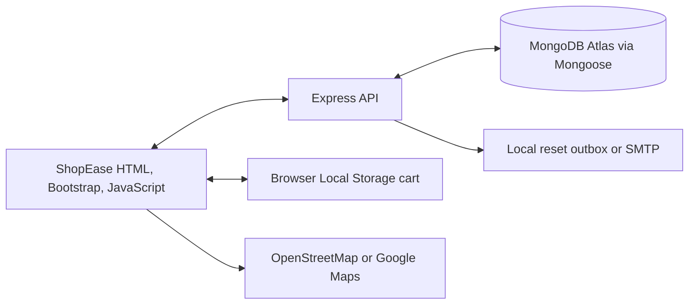
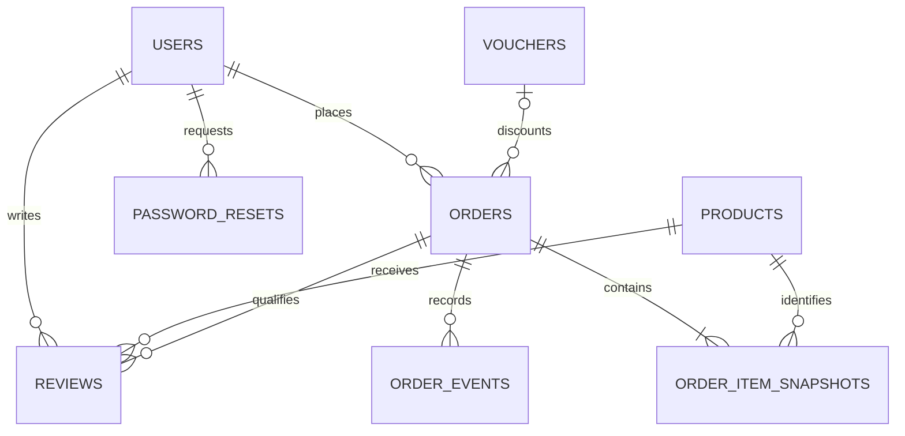

# ShopEase local rubric evidence

## Scope and architecture

The frontend uses HTML5, CSS3, Bootstrap 5, and JavaScript modules. Node.js and Express serve the frontend and same-origin API. MongoDB Atlas stores accounts, products, orders, order events, reviews, vouchers, and password reset tokens through Mongoose. Local Storage preserves the browser cart. Git tracks the project in the GitHub repository.

Order item snapshots are stored inside `orders.items` as JSON. Delivery coverage checks the municipality, and checkout checks the shipping address for the same service area. Order updates are pushed to active customer pages by server-sent events with a periodic refresh as a fallback.

| Proposal item | Implementation |
| --- | --- |
| Customers | Catalog, account dashboard, profile, cart, delivery checkout, order history, purchased-product reviews, and reset links |
| Staff | Team sign-in, workload summary, order queue, status transitions, and inventory adjustments |
| Administrators | Team sign-in, product management, administrator-only account creation, vouchers, analytics, and Excel export |
| ERD | One customer to many orders and reviews, one product to many reviews, and one order to many reviews. Order items retain their product IDs, names, quantities, and unit prices. |
| Checkout | Server-side prices and discounts, delivery-zone checks, transactional stock deduction, idempotent submission, and printable confirmation |
| Store locator | Polangui demo coverage, Google Maps JavaScript API with a Demo key locally, and an OpenStreetMap fallback |

## Evidence by phase

| Phase | Local evidence to capture or include | Still required for final submission |
| --- | --- | --- |
| 1 | Approved proposal and role-to-page mapping, revised ERD and architecture | Team approval for the final diagrams, actual delivery locations, and payment rubric interpretation |
| 2 | `/backend` API and README, Mongoose schemas, Atlas connection, and MongoDB integration suite | Atlas screenshots, backend lab PDF, and group contribution notes. |
| 3 | Named HTML pages, Bootstrap forms, annotated current screenshots, and the original frontend report | Each member’s reflection and GitHub folder screenshot from the submission revision |
| 4 | Customer and product creation, checkout, reviews, error states, backend test results | Atlas insertion evidence, phase commit history, and reflections |
| 5 | Catalog and staff/admin displays, observed JSON, filters, empty states, rendering code, and phase report | Reflections and publication of the `phase-5` tag |
| 6 | Product editor and deletion confirmation, observed MongoDB before/after values, saved profile and stock changes, cancellation tests | Atlas console before/after evidence if required and team reflections |
| 7 | Local integration tests and desktop/mobile browser checks | Live Render checks and URLs, final team reflections and PDF, `v1.0-final`, and `phase-7-final` |

MongoDB generates `_id` values and retains the application's public UUIDs. Checkout and cancellation use MongoDB transactions. Unique indexes enforce one order per customer/request pair and one review per customer, order, and product.
